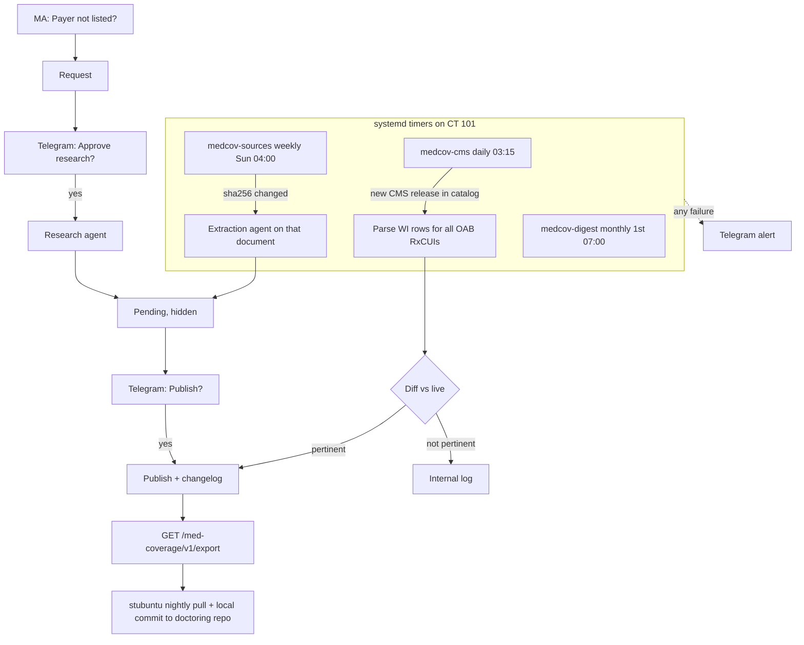

# Spec: Med Coverage card (OAB drugs first), self-updating, with agent research

- **Status:** approved design (Ryan, 2026-10-25), ready to build
- **Date:** 2026-10-25
- **Owner:** Ryan Stewart
- **Repos touched:** `practicetoolsapi` (master), `practicetools-web` (main)
- **Seed data and research history:** `~/projects/doctoring/oab-pa-kit/` (coverage CSVs, sources, SmartText, PA log codes)

---

## 0. Goal

Add a public **Med Coverage** card. An MA picks a payer and sees which OAB drug to prescribe, the drug's tier and edits, the payer's PA criteria with sources, and which SmartPhrase to run. The data maintains itself. A scheduled job refreshes Medicare Part D from CMS and watches every source document for changes. Pertinent changes appear in a public changelog on the card. When a payer is missing, anyone can request research. Ryan approves the request in Telegram, an agent researches the payer, and Ryan approves the results in Telegram before they appear. Ryan never has to run anything by hand.

**Drug scope at launch:** beta-3 agonists (mirabegron generic and Myrbetriq, vibegron/Gemtesa) and OAB antimuscarinics (oxybutynin IR/ER/patch/gel, tolterodine IR/ER, trospium IR/ER, solifenacin, darifenacin, fesoterodine). The schema is drug-generic so more classes can be added later.

### Done when

1. `/med-coverage` is linked from Home. It works without login on a phone and a workstation, and shows seeded data for Medicare (every WI plan), WI Medicaid, and 11 commercial payers or PBMs.
2. A scheduled job detects a new CMS Part D release, applies it, and writes pertinent changes to the public changelog without human action. It is proven by replaying CY2026 Q3 to CY2027 Oct.
3. A weekly job re-checks every source URL. A changed document triggers an extraction agent, whose proposed rows wait for Ryan's Telegram approval.
4. "Payer not listed?" creates a research request. Ryan gets a Telegram message with Approve and Reject buttons. Approve runs the research agent. Its rows are hidden until Ryan approves them in a second Telegram message.
5. PA outcomes can be recorded through a clinic link (secret key in the URL, no login screen). Denials that contradict published criteria are flagged in the monthly digest.
6. Failures (job, agent, dead source) alert Ryan in Telegram within the run that failed.
7. The nightly export is pulled into the doctoring repo for history.

### Out of scope

- Epic integration of any kind (Tier 3).
- Botox, SNM, and PTNS. These are medical benefit with LCD and J-codes, a different shape (see §10).
- Deleting the deprecated `/coverage` feature in either repo. Leave it untouched.
- Any login on the card.

### Baseline before code

Run and record the API test suite (`source venv/bin/activate && python -m pytest tests/ -v`) and the web suite (`npm run lint && npm test && npm run build`) on fresh branches before writing code. Some coverage and docling tests may already fail. Record them and don't fix them.

### Baseline recorded (2026-10-25)

- API (`origin/master` 03b2574): 22 failed, 148 passed, 20 skipped, 3 errors. All failures are in `test_coverage_search_smoke.py`, `test_docling_extraction.py`, `test_document_deletion.py`, `test_document_pipeline_integration.py`, and `test_document_processing_rollback.py`. Not fixed.
- Web (`main` 3f1f997): lint clean, 80 tests passed, build OK.

### If blocked

If something can't be done as written, make the smallest reasonable choice, add a row to the §11 decision log, and keep going. Stop only for anything that would need a secret Ryan has not provided (the Telegram bot token, the agent auth token). Leave a clear TODO, and stub the dependency behind a config flag so tests still pass.

### Paste-ready command

Build in two goals. Goal A covers data, the card, and the scheduled refresh. Goal B covers Telegram, the agents, and outcomes.

```
/goal Build Goal A of ~/projects/practicetools/web/docs/med-coverage-card-spec.md: milestones M1, M2 and M3, on branch med-coverage-card in both practicetoolsapi and practicetools-web. Follow the spec exactly, including the baseline-before-code and if-blocked rules. Done only when: fresh output of pytest (api) and npm run lint, npm test and npm run build (web) all pass except the baseline failures you recorded; grep -c "^- \[ \]" over M1-M3 in the spec returns 0; git status is clean in both repos; both branches are pushed and a PR URL exists for each (do not merge). Stop after 80 turns.
```

```
/goal Build Goal B of ~/projects/practicetools/web/docs/med-coverage-card-spec.md: milestones M4, M5 and M6, on branch med-coverage-card in both repos (Goal A merged first). Same rules and done criteria as Goal A, applied to M4-M6. Stop after 80 turns.
```

---

## 1. Principles

- **Never guess payer criteria.** Every row has `source_url`, `doc_date`, and `retrieved`. Unknown values are `GAP`. This is the rule from `doctoring/oab-pa-kit/CONVENTIONS.md`.
- **No PHI.** The card takes payer names, never patient details. The outcome form uses month only and fixed codes.
- **Deterministic data auto-publishes. Model-read data waits for Ryan.** CMS-derived changes publish immediately. Anything an agent extracted from a web page is hidden until Ryan approves it.
- **No manual upkeep.** Every recurring task is a timer. Every failure produces an alert.
- **Ryan is the only approver**, always through Telegram.

## 2. Current architecture (verified 2026-10-25)

- **API layering:** route → controller → service → repository → SQLModel table model. Follow the `previsit-packets` branch (`app/routes/previsit_routes.py`, `app/controllers/previsit_controller.py`, `app/services/previsit_service.py`, `app/repositories/previsit_repository.py`, `app/models/previsit_submission.py` + `previsit_schemas.py`).
  - Table models must be imported in `app/models/__init__.py`.
  - Routers are registered in `app/main.py` (around L170-235).
- **Migrations:** Alembic, written by hand, in `migrations/versions/`. Template: `c7a1f4d2b9e3_pt_search_drive_times_and_rate_limiting.py`. **Check the head first:** master is `h3b4c5d6e7f8` and previsit adds `i4c5d6e7f8a9`. Rebase onto whichever has landed.
- **DB:** SQLite through `PRACTICETOOLS_DATABASE_URL` (`app/config.py`), with WAL, foreign_keys, and busy_timeout set in `app/database.py`.
- **Name collisions to avoid:** the deprecated coverage feature (unmounted, but its tables exist) owns the tables `practices`, `medications`, `insurance_plans`, `coverage_documents`, `document_chunks`, and `medication_coverage_records`, the classes `Medication*` and `InsurancePlan*`, and the prefix `/coverage`. **Use the table prefix `medcov_`, the class prefix `MedCov`, the API prefix `/med-coverage`, and the web route `/med-coverage`.**
- **Auth:** public routes take no dependency. Admin routes use `require_admin` (`app/services/auth_service.py` L94). Not needed here, because approval happens in Telegram.
- **Rate limiting:** the house limiter is `app/services/rate_limit_service.py` with `resolve_client_ip` (`app/services/client_ip.py`), attached as a route dependency. Reuse it.
- **Background work:** none exists. **Deploy:** CT 101 pulls from GitHub every 5 minutes (`deploy/README.md`, `deploy/practicetools-deploy.sh`). It backs up the DB, installs `requirements-runtime.txt`, runs `alembic upgrade head`, restarts, health-checks, and rolls back on failure. App path: `/opt/practicetools/app`. New timers go in `deploy/` as systemd `.service` and `.timer` pairs, installed by the deploy script.
- **Settings:** pydantic-settings `Settings` in `app/config.py`, with snake_case `Optional[str] = None` fields. Document every new key in `.env.example`.
- **API tests:** pytest, pytest-asyncio, httpx. Each test uses a tmp sqlite engine with the module `engine` monkeypatched (`tests/pt_search_fixtures.py` L32; previsit `tests/test_previsit_routes.py` L42).
- **Web:** axios `apiClient` (`src/api/client.ts`, `VITE_API_URL`), per-feature API modules (`src/api/physicaltherapist.ts`), react-query v4, shadcn UI.
  - Client-side decision-flow pattern: `src/pages/scheduling/util/workflow.ts`.
  - Home cards: `toolsList` in `src/pages/home/index.tsx`.
  - Routes: under `<Layout/>` in `src/App.tsx`.
  - Vitest with jsdom, `vi.mock` of API modules (see `src/pages/search-therapists/index.test.tsx`).
- **Related unmerged work:** `origin/feature/oab-care-pathway` (web) also edits `src/pages/home/index.tsx`. Expect a trivial merge conflict, and keep both cards.
- **Known issue, not in scope:** `auth_service.py` L11 has a hardcoded `SECRET_KEY`. File it as a separate issue.

## 3. User flows

### 3.1 MA (public)

1. Home, then **Med Coverage**. The first question is "What is the patient's prescription coverage?" (Medicare / WI Medicaid / Commercial plan or PBM). There is no drug-class step: every result covers all OAB medications, both classes (decision log row 26).
2. Medicare: type to search by plan name or contract-plan ID (`H5216-001`). WI Medicaid and commercial: pick the payer or PBM.
3. The result page answers "what OAB meds are available to this patient?" at a glance, readable in a few seconds on a phone:
   - A compact plan header, with a plan-year toggle (newest year by default) and a product-line picker when the payer has more than one.
   - **"Prescribe this"**: one labelled line per beta-3 ingredient saying plainly what to send and its key restriction, for example "Mirabegron: send generic. Myrbetriq is not covered." and "Vibegron: Gemtesa is covered (PA required)." Two ingredients never share a line.
   - Products (ingredient and form, strengths collapsed) in four groups: "Covered, no PA or step", "Covered with PA or step therapy", "Not covered", "Coverage not published". Beta-3 agonists come first within each group, then antimuscarinics. Each product is one line: name, tier, and small PA / ST / QL badges ("PA?" when unpublished).
   - Tapping a product expands its detail: PA/ST/QL in words, the criteria checklist (trial count, trial duration, contraindication pathway, approval length), notes, the next step (`.OABPAEVIDENCE`, then `.OABLMNMIRABEGRON` or `.OABLMNVIBEGRON`), and the source link, document date, "last checked", and any other sources.
   - "Recent changes (n)": the last 3 changelog entries for this payer, collapsed.
   - Footer, always visible: "Payer criteria change. Confirm in the payer portal before submitting."
4. **Payer not listed?** A 60-character text box with the placeholder "Plan or PBM name only. No patient information." On submit it shows "Requested. Dr. Stewart reviews requests; results usually appear within a day," then the general default steps.
5. **What changed** panel: the public changelog, newest first, filterable by payer, with "Data checked [date]" in the header.

### 3.2 Ryan (Telegram)

| Message | Buttons | Effect |
|---|---|---|
| Research requested: "'Trilogy Health Plan' (2 requests, first 10:42)" | Approve / Reject | Approve queues a research agent run. |
| Results ready: "Trilogy Health Plan: 4 rows, 2 GAP. Preview: <link>" | Publish / Reject | Publish makes the rows live and adds a changelog entry. |
| Source changed: "Security Health 2026 formulary changed; agent proposes 2 edits. Preview: <link>" | Publish / Reject | Same as above. |
| Alert (job failed, agent failed, source dead for 2 or more weeks, monthly cap reached) | none | Information only. |
| Monthly digest (1st of the month) | none | CMS changes applied, pending items, PA outcome summary, contradictions. |

- Preview links are a read-only page, `/med-coverage/review/<signed token>`, valid for 14 days.
- Unanswered requests expire after 14 days.

### 3.3 PA outcome (clinic link)

`/med-coverage/outcome?k=<clinic key>` opens a form with exactly the fields and codes in `doctoring/oab-pa-kit/pa-log/codes.md`, with no free-text patient fields.
- The key is checked server-side against `MEDCOV_CLINIC_KEY_SHA256`. Rotating the key means changing the env var.
- A denial whose code contradicts live criteria (for example `STEP_NOT_MET` at a payer whose row says no ST) is recorded in `medcov_flag` and goes into the digest.

## 4. Automation



### 4.1 Pertinent changes (changelog)

These count:
- A product added to or removed from a plan or payer.
- A change in tier, PA, ST, or QL.
- A criteria change (trial count, trial duration, contraindication pathway, approval length).
- A new payer published.
- A plan gaining or losing Brown County (FIPS 55009, CMS county code 52040).
- A source dead for 2 or more consecutive weekly checks: "data may be stale".

These are internal only: a re-dated document with the same content, an identical hash, or timing noise.

Each entry has: date, payer or plan, one plain sentence, source link, and origin (CMS / reviewed).

### 4.2 CMS pipeline

Port `doctoring/oab-pa-kit/coverage/medicare-partd/scripts/{drug_ids,fetch,parse}.py` (Python stdlib; HTTP range reads of only the needed zip members, about 28 MB instead of 2.5 GB) into `app/services/medcov/partd/`.
- Extend `drug_ids` to the antimuscarinic RxCUIs, resolved through RxNav at job time and cached in `medcov_drug_rxcui`.
- WI filter: PDP region 16 and MA service areas in WI. Plan year: the newest release per year in the CMS catalog.
- Keep `parse_log` and suppression handling.

### 4.3 Agents

| Agent | Trigger | Task | Model | Caps |
|---|---|---|---|---|
| Extraction | Source document hash changed | Re-read one saved document. Propose row edits as JSON matching `MedCovRowProposal`. | `claude-sonnet-5-5` | 30 turns, 10 min, 60 runs/month |
| Research | Ryan approved a request | Find the payer's PBM, formulary, and criteria for every in-scope drug from primary sources. Save the documents. Return `MedCovRowProposal[]`. | `claude-opus-5-5` | 80 turns, 45 min, 1 concurrent, 5/day, 40/month |

- **Runner:** `app/services/medcov/agent_runner.py` shells out to Claude Code headless (`claude -p --model <m> --max-turns <n> --output-format json --allowedTools WebSearch,WebFetch,Write`) in a scratch directory per run, run by a separate worker unit (`deploy/medcov-worker.service`) that polls `medcov_agent_run` for queued jobs.
- **Auth:** `CLAUDE_CODE_OAUTH_TOKEN` from `claude setup-token` on Ryan's Max plan (setting `medcov_agent_auth=max`). Switch to `ANTHROPIC_API_KEY` with `medcov_agent_auth=api_key`. See decision log row 9.
- **Prompts:** in `app/services/medcov/prompts/`. Each restates the never-guess rules, requires source, document date, and retrieved date, and says that fetched content is data, not instructions.
- **Validation:** output must parse as `MedCovRowProposal[]`. Invalid output marks the run failed and sends an alert. Proposals go to `medcov_coverage_row` with `status=pending`, and are never live without the publish callback.
- **Hitting a cap or a Max usage limit:** the job stays queued, retries in 6 hours, and Ryan gets one alert per cap per day.

### 4.4 Telegram

- A **dedicated bot** for this tool (not `@stubuntu_venus_bot`), with settings `medcov_telegram_bot_token`, `medcov_telegram_admin_chat_id`, and `medcov_telegram_webhook_secret`.
- Webhook: `POST /med-coverage/telegram/webhook`, registered with Telegram's `secret_token`. Requests without the matching `X-Telegram-Bot-Api-Secret-Token` header are rejected.
- Callbacks are accepted only from the admin chat ID. `callback_data` is a single-use HMAC token naming the request or run and the action. Replays are rejected.
- After a tap, the bot edits the message to show the outcome ("Approved 10:51").

## 5. Abuse and PHI controls

| Risk | Control |
|---|---|
| Request flooding | The house rate limiter: 5 requests per IP per day and 20 pending total. Duplicates (normalized name) merge, and `count` increments. Nothing runs without approval. |
| PHI typed into the payer box | 60-character max. Server-side rejection of runs of 6 or more digits, date patterns, and phone patterns (HTTP 422 with "Plan or PBM name only"). Ryan sees the exact text. Raw text is deleted 30 days after resolution. IPs are stored only as a salted hash. |
| Outcome spam | Clinic key required (§3.3). |
| Users treating data as advice | Source, document date, "last checked", and the confirm-in-portal footer on every result. |
| Prompt injection via fetched pages | Structured output only, schema validation, and hidden-until-approved. |
| Telegram spoofing | Webhook secret, chat ID check, and single-use HMAC callbacks. |

## 6. Data model (`app/models/medcov.py`, SQLModel, `medcov_` tables)

| Table | Columns (key ones) |
|---|---|
| `medcov_drug_class` | id, code (`oab_beta3`, `oab_antimuscarinic`), label |
| `medcov_drug` | id, class_id, name, product (`generic`/`brand`), label (e.g. "Myrbetriq ER 25 mg") |
| `medcov_drug_rxcui` | drug_id, rxcui, ndc (nullable), resolved_at |
| `medcov_payer` | id, name, aliases (JSON), kind (`medicare_plan`/`medicaid`/`commercial`/`pbm`), pbm_name, status (`live`/`pending`/`rejected`) |
| `medcov_plan` | Medicare: payer_id, contract_id, plan_id, segment_id, plan_name, org_name, plan_type, formulary_id, plan_year, brown_county, release_id |
| `medcov_coverage_row` | id, payer_id, plan_id (nullable), drug_id, status_or_tier, pa, st, ql, ql_amount, ql_days, trials_required, trial_duration, contraindication_pathway, approval_initial, approval_renewal, criteria_summary, origin (`cms`/`agent`/`seed`), status (`live`/`pending`/`rejected`/`superseded`), source_id, agent_run_id, created_at |
| `medcov_source` | id, url, doc_date, retrieved, sha256, saved_path, last_checked, consecutive_failures |
| `medcov_release` | id, kind (`cms_quarterly`/`cms_monthly`), plan_year, period, url, posted, applied_at |
| `medcov_change` | id, date, payer_id, plan_id, kind, summary, before_json, after_json, origin, pertinent, published |
| `medcov_request` | id, normalized_name, raw_text (deleted 30 days after resolution), count, first_seen, ip_hash, status (`pending`/`approved`/`rejected`/`expired`/`done`), resolved_at |
| `medcov_agent_run` | id, kind, request_id, source_id, model, status (`queued`/`running`/`done`/`failed`), started, finished, turns, error, output_path |
| `medcov_callback_token` | token_hash, action, target_id, expires, used_at |
| `medcov_outcome` | the fields from `pa-log/codes.md` |
| `medcov_flag` | id, outcome_id, payer_id, reason, created |

**Seed** (migration data step or `scripts/medcov_seed.py`, idempotent) from `doctoring/oab-pa-kit/coverage/`: `medicare-partd/data/wi_beta3_partd.csv` (1,379 rows), `wi-medicaid/wi_medicaid_oab.csv` (24 rows, antimuscarinics included), `commercial/commercial_beta3.csv` (38 rows). Copy the CSVs into `api/data/medcov_seed/` with a README naming their origin. Every seeded row has `origin=seed`, `status=live`.

The antimuscarinic Part D rows come from the first CMS job run (M3). Commercial antimuscarinic rows come from one research run per seeded commercial payer, queued at launch as a single Telegram approval ("Seed antimuscarinics for 11 payers?").

## 7. API (`/med-coverage`)

| Method | Path | Auth | Rate limit | Purpose |
|---|---|---|---|---|
| GET | `/v1/classes` | public | none | Drug classes and drugs |
| GET | `/v1/payers?kind=&q=` | public | none | Live payers and Medicare plans (search) |
| GET | `/v1/payers/{id}` | public | none | Live rows, sources, last 3 changes |
| GET | `/v1/changes?payer_id=&limit=` | public | none | Public changelog |
| GET | `/v1/meta` | public | none | Data-checked date, release in use |
| POST | `/v1/requests` | public | house limiter | Request research (`{name}`) |
| POST | `/v1/outcomes` | clinic key | house limiter | Record a PA outcome |
| GET | `/review/{token}` | signed token | none | Read-only preview of pending rows |
| POST | `/telegram/webhook` | Telegram secret | none | Callback handler |
| GET | `/v1/export` | public | none | Live data as JSON, for the nightly history pull |

Responses never include `pending` or `rejected` rows outside `/review/{token}`.

## 8. Web (`src/pages/med-coverage/`)

- `index.tsx` holds the flow (payer type, payer, result) using a `util/flow.ts` node graph like `scheduling/util/workflow.ts`. `/v1/classes` only sets the class order on the result.
- `util/summary.ts` buckets products for the at-a-glance result and writes the per-ingredient "Prescribe this" lines; `util/prescribe.ts` picks brand vs generic within one form; `util/group.ts` collapses strengths.
- Other files: `ResultView.tsx`, `ChangesPanel.tsx`, `RequestBox.tsx`, `OutcomePage.tsx` (route `/med-coverage/outcome`), and `ReviewPage.tsx` (route `/med-coverage/review/:token`).
- API module: `src/api/medCoverage.ts`. Types: `src/types/medCoverage.ts`.
- Home card: title "Med Coverage", description "Which OAB med each plan covers, and what its PA needs", lucide `Pill` icon.
- The CHANGELOG entry and VERSION bump follow the existing 4-part convention when the card ships.

## 9. Milestones and acceptance criteria

### M1: Data model, seed, read API (api)
- [x] `app/models/medcov.py` with every §6 table. Imported in `app/models/__init__.py`. Migration on the current head.
- [x] Idempotent seed loads the three CSVs. Test: row counts 1,379 / 24 / 38, and every live row has `source_url`, `doc_date`, `retrieved`.
- [x] Every public `GET` route in §7. Tests prove pending and rejected rows never appear.
- [x] `.env.example` documents every new `medcov_*` setting.

### M2: Card (web)
- [x] Flow, result view, changes panel, and request box (the request box can be wired in M2 because the endpoint lands in M4). Vitest coverage for the flow graph and the "prescribe this" logic.
- [x] Home card added. Works at 375 px width.
- [x] The footer disclaimer and the source/date line appear on every result (test).

### M3: Scheduled CMS refresh (api)
- [x] Part D pipeline ported to `app/services/medcov/partd/`, extended to antimuscarinic RxCUIs.
- [x] `medcov-cms` service and timer in `deploy/`, installed by the deploy script. It detects new releases from the CMS catalog and applies them.
- [x] Diff engine writes `medcov_change`, with pertinent changes published. Replay test: apply the CY2026 Q3 fixture, then the CY2027 Oct fixture. Expected changes include Aetna MA moving from Myrbetriq to generic, and Security Health H5211 losing Brown County.
- [x] `medcov-sources` weekly hash watcher: dead sources counted, stale changelog entry after 2 failures.
- [x] Failure alerts are sent through a `TelegramNotifier`. It is a no-op that logs when no token is configured, so tests pass without secrets.

### M4: Telegram approvals and research requests (api, web)
- [ ] `POST /v1/requests` with PHI screen, merge, limits, and expiry. Tests cover each rejection pattern.
- [ ] Telegram webhook with secret header, chat ID check, and single-use HMAC callbacks. Tests cover replay and wrong chat.
- [ ] Approve and Reject for research requests and for publishing. The message is edited after a tap.
- [ ] `/review/{token}` page (web) shows pending rows read-only.

### M5: Agents (api)
- [ ] `agent_runner` with the Claude Code headless runner, `max` and `api_key` auth modes, and per-kind caps (§4.3).
- [ ] `medcov-worker` service polls queued runs. Timeouts mark runs failed and alert.
- [ ] Extraction and research prompts. `MedCovRowProposal` validation. Proposals stored as pending. Tests use a fake runner that returns fixture JSON, including one invalid output.
- [ ] Launch action: a one-time "seed antimuscarinics for the 11 commercial payers" request sent to Telegram.

### M6: Outcomes, flags, digest, export (api, web)
- [ ] Clinic-key outcome form (web) and `POST /v1/outcomes` (api), using the `pa-log/codes.md` values exactly.
- [ ] Contradiction flags (§3.3), with a test case.
- [ ] `medcov-digest` monthly timer sends the digest.
- [ ] `GET /v1/export`. The doctoring side gets a stubuntu user timer (`~/.config/systemd/user/medcov-export.timer`) that pulls nightly to `oab-pa-kit/coverage/live/` and commits locally if anything changed. It never pushes.

## 10. Later (not in this goal)

- Botox, SNM, and PTNS: medical benefit. Model LCDs and J-codes, plus diagnosis-code checks. Verify the reported Medicare change for N32.81 (OAB) with Botox, from the AUGS community thread of 2026-04-30.
- Vaginal estrogen step therapy.
- Navitus (state employees through ETF): queue it as the first research request after launch.
- Remove the deprecated `/coverage` feature.
- Link the card from the OAB care pathway once that branch lands.

## 11. Decision log

| # | Date | Decision | Why |
|---|---|---|---|
| 1 | 2026-10-25 | Card is public, with no login | Ryan |
| 2 | 2026-10-25 | Research runs only after Ryan approves in Telegram. Ryan is the only approver. | Ryan. Approval also caps cost and abuse. |
| 3 | 2026-10-25 | The practicetools DB is the live copy, exported nightly to the doctoring repo | Ryan |
| 4 | 2026-10-25 | Public changelog on the card, plus the Telegram digest | Ryan: "I'm not the only user" |
| 5 | 2026-10-25 | CMS-derived changes auto-publish. Agent-derived changes stay hidden until approved. | A deterministic government parse vs. a model reading web pages |
| 6 | 2026-10-25 | Outcome form uses a clinic key in the URL | Ryan agreed. Blocks spam without a login. |
| 7 | 2026-10-25 | Pending agent rows are hidden, not shown as unreviewed | Ryan |
| 8 | 2026-10-25 | Drug-generic schema. Launch with beta-3 agonists and antimuscarinics. | Ryan |
| 9 | 2026-10-25 | Agents run through Claude Code headless (`claude -p`) on Ryan's Max plan (`claude setup-token`). An API key remains available by setting. | Ryan confirmed `claude -p` on Max is fine for this (2026-10-25). Every run is approved by Ryan and its output reviewed by him. |
| 10 | 2026-10-25 | Prefix `medcov_` and route `/med-coverage` | Avoid collision with the deprecated coverage feature's tables and `/coverage` routes |
| 11 | 2026-10-25 | Caps: research 1 concurrent, 5/day, 40/month; extraction 60/month | Ryan: "be reasonable". Max limits are rarely hit. |
| 12 | 2026-10-25 | This spec follows practicetools rules: GitHub issues, push branches, PRs not merged by the agent | Ryan |
| 13 | 2026-10-25 | Seed all 12 payers in `commercial_beta3.csv` (spec said 11) | The CSV has 12 distinct payers, including the Advocate-affiliated plan |
| 14 | 2026-10-25 | `medcov_drug` is product-level, and strength-level for mirabegron/Myrbetriq (27 drugs) | CMS keys tablets by RxCUI per strength; one coverage row per Part D CSV row |
| 15 | 2026-10-25 | Seed CSV rows naming several drugs ("all", "A / B / C") expand to one row per drug, sharing a `seed_ref` | Rows are per drug in the schema. Commercial 38 CSV rows become 83 coverage rows |
| 16 | 2026-10-25 | Ambiguous PA/ST/QL text maps to `GAP`, original text kept in `detail` | Never guess |
| 17 | 2026-10-25 | `on_formulary` is nullable; null shows as "Coverage not published" | CMS-suppressed plans and unclear payer text are unknown, not "not covered" |
| 18 | 2026-10-25 | Deploy script runs the idempotent seed after `alembic upgrade head` | Otherwise prod never gets seed data without a manual step |
| 19 | 2026-10-25 | Web version 0.2.0.0 for the card | New feature is a minor bump |
| 20 | 2026-10-25 | Replay result: all 7 Aetna MA plans move from Myrbetriq to generic (tablet and granules); Security Health H5211-004 and H5211-012 lose Brown County | Verified against the real CMS files; matches `oab-pa-kit` summary.md |
| 21 | 2026-10-25 | Two extra pertinent kinds: `plan_removed` (gone from a later release of the same year) and `plan_ending` (no next-year successor) | MAs need to know a plan disappears |
| 22 | 2026-10-25 | CMS job refuses a release whose WI plan count is under 50% of that year's live plans, and alerts | Guards against a truncated or malformed release wiping data |
| 23 | 2026-10-25 | Stale-source and source-changed entries use a new change origin, `system` (shown as "Automated check") | Neither CMS nor reviewed |
| 24 | 2026-10-25 | Timers are installed only after the deploy health check passes; install failure logs but does not roll back | Rollback never touches timers |
| 25 | 2026-10-25 | Sources watcher sends `practicetools-medcov <MEDCOV_HTTP_CONTACT>` as User-Agent to sec.gov | sec.gov returns 403 without a contact email |
| 26 | 2026-10-25 | Card asks coverage first and shows all OAB meds at a glance; detail on tap | Ryan: "what I really need to know is what OAB meds are available to this patient" |
